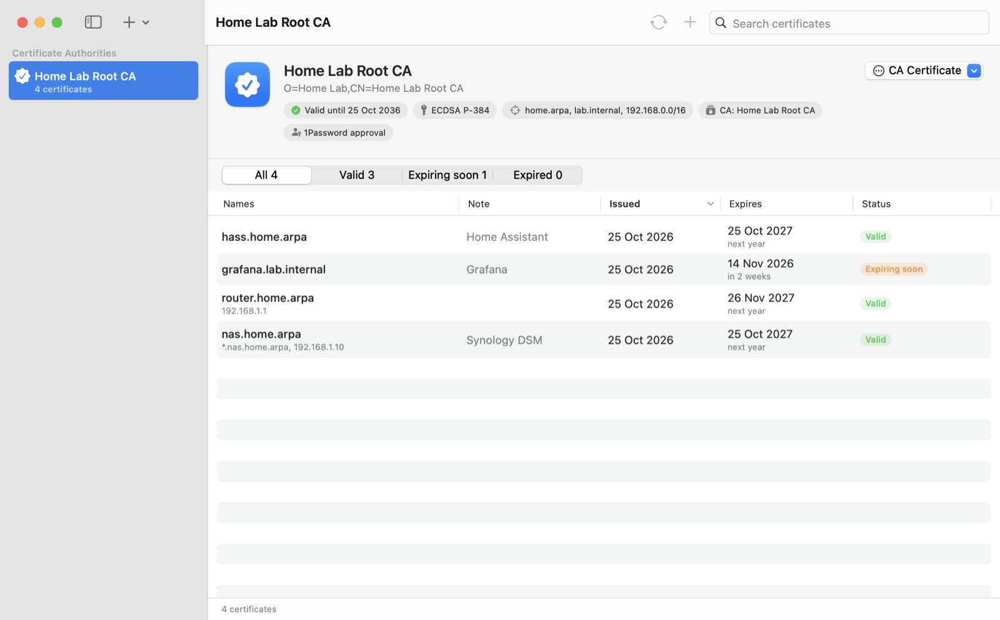

# Cert Lab

**TLS certificates for your home lab, signed by a certificate authority kept in 1Password.**

Cert Lab is a small macOS app for running your own private CA. You create (or import) a CA once, trust it on your devices, and then issue certificates for your NAS, router, Home Assistant, Grafana and anything else on your network. The CA lives in its own 1Password vault, so issuing a certificate needs 1Password's approval. There are no CA keys sitting on your disk.



## Features

- **Create or import a CA.** Generate an ECDSA or RSA CA, or import an existing certificate and key (PKCS#8, SEC1, PKCS#1 or encrypted PKCS#8).
- **Issue certificates in seconds.** Enter hostnames and IP addresses, pick an expiry date, and get back the private key, the certificate, the full chain and the CA certificate. You can copy them or export them as files.
- **Private keys are shown once.** Issued keys are never stored anywhere: not on disk, not in 1Password, not in the log.
- **Issuance history.** A searchable log of everything each CA has issued, showing what's valid, expiring soon or expired. It syncs through 1Password, so every Mac sees the same history.
- **Name constraints.** Optionally limit a CA to domains like `home.arpa` and ranges like `192.168.0.0/16`, so trusting it can't be abused for other websites.
- **Optional passphrase.** If you want issuing to need more than 1Password's approval, you can also protect a CA's key with a passphrase.
- **No lock-in.** Everything is stored in standard formats that work with `openssl`.

## Requirements

- macOS 14 or later
- The [1Password](https://1password.com) desktop app, with **Settings › Developer › Integrate with 1Password CLI** turned on
- The [1Password CLI](https://developer.1password.com/docs/cli/get-started/): `brew install 1password-cli`

## Installing

Download the ZIP from [GitHub Releases](https://github.com/viaductindustries/cert-lab/releases), unzip it, and move **Cert Lab.app** to `/Applications`. Release downloads are signed with Developer ID and notarized by Apple, and support both Apple Silicon and Intel Macs. If no release has been published yet, build from source below.

### Building from source

You can also build Cert Lab yourself. It takes a couple of minutes.

You'll need:

- **Xcode 16.3 or later** (from the App Store), or a Swift 6.1+ toolchain. Check with `swift --version`. If you've just installed Xcode, open it once to finish setup, or run `sudo xcode-select -s /Applications/Xcode.app`.
- **The 1Password app and CLI**, as described under [Requirements](#requirements).

Then:

```sh
git clone https://github.com/viaductindustries/cert-lab.git
cd cert-lab
scripts/build-app.sh --install
```

This compiles a release build, wraps it in `Cert Lab.app`, signs it ad hoc for this Mac and copies it to `/Applications`. Apps you build yourself aren't quarantined, so Cert Lab opens normally.

The first time Cert Lab uses 1Password, 1Password asks you to approve access. If Cert Lab can't find `op`, set its path in **Cert Lab › Settings**, and use **Test Connection** there to check everything works.

To update later:

```sh
git pull
scripts/build-app.sh --install
```

Your CAs and history aren't affected by reinstalling. They live in 1Password and `~/Library/Application Support/Cert Lab/`.

## Using Cert Lab

1. **Add a CA:** create a new one, import one, or link one you set up on another Mac. A new or imported CA gets its own 1Password vault (`CA: <name>` by default).
2. **Trust the CA:** from the CA's menu choose **Export CA Certificate…**, then install it on the devices and browsers that should trust your certificates.
3. **Issue certificates:** press ⌘N, enter names, and approve the request in 1Password. Save the private key before closing the result; it can't be shown again.
4. **Sync:** press ⌘R to save any certificates that didn't reach 1Password and to fetch ones issued on other Macs.

## How your data is stored

| Where | What |
|---|---|
| The CA's 1Password vault | The CA item (certificate and private key), plus one item per issued certificate (certificate and details, never its key) |
| `~/Library/Application Support/Cert Lab/` | Which CAs are linked on this Mac, and a local cache of the issuance log |

Anyone with access to a CA's vault can issue certificates from it. If you turn on a CA passphrase, the key is stored encrypted (PKCS#8 with PBKDF2-SHA256 and AES-256-CBC). That only helps if you keep the passphrase *outside* that vault.

Issued certificates include their SANs and `serverAuth` (plus `clientAuth` if you choose it). Cert Lab warns about lifetimes over 825 days, because Apple devices reject longer-lived TLS certificates. CAs are created with `pathLen 0`, so they can sign certificates but not other CAs.

## Development

```sh
swift test                       # tests (uses openssl for interoperability checks)
scripts/build-app.sh             # → build/Cert Lab.app
scripts/build-app.sh --install   # build and copy to /Applications
```

This is a plain Swift package; there's no Xcode project. `Sources/CertLabCore` contains the crypto, 1Password and storage code, and `Sources/CertLab` is the SwiftUI app. CI runs the tests and builds a universal app on pushes to `main` and pull requests. Development builds are available as workflow artifacts. Release Please maintains version-bump PRs and changelogs; merging a release PR creates the GitHub Release and runs the signed and notarized build; see [Release setup and credentials](docs/releases.md) for the GitHub secret names, upload locations, and publishing steps.

Commit messages follow [Conventional Commits](https://www.conventionalcommits.org/) (`feat: …`, `fix: …`, etc.). [AGENTS.md](AGENTS.md) records the project's design decisions and conventions, for both people and coding agents.
